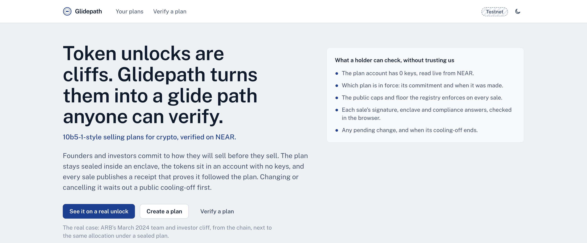
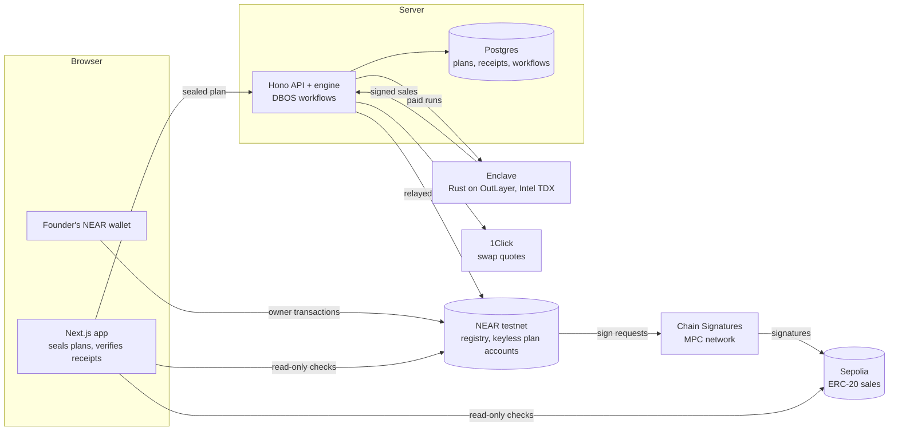

# Glidepath

Glidepath lets token insiders sell on a schedule nobody can see, while anyone can check every sale
followed it.

Founders and investors commit to how they will sell before they sell, like the
[Rule 10b5-1 plans](https://www.sec.gov/rules-regulations/2022/12/rule-10b5-1-insider-trading-arrangements-related-disclosures)
company insiders use, without a broker. The plan is sealed inside an enclave, the tokens sit in an
account with no keys, public limits hold on every sale, and every sale leaves a receipt that anyone
can check in their browser.

**Try it:** https://glidepath.clanker.show
**Check it:** `pnpm verify https://glidepath.clanker.show` rechecks every receipt on the live site
against NEAR testnet and Sepolia, with no keys and nothing signed ([what it checks](#check-the-live-site)).
**Run it:** `cp .env.example .env && pnpm install && pnpm dev:local`, then http://localhost:3400
(details in [Run it locally](#run-it-locally)).

On NEAR testnet and Sepolia. The 1Click swap service is simulated on its real API, because it has
no testnet; everything else on the live site is real.



## Contents

- [The problem](#the-problem)
- [What it does](#what-it-does)
- [Screenshots](#screenshots)
- [Try it: do this, see that](#try-it-do-this-see-that)
- [Check the live site](#check-the-live-site)
- [Run it locally](#run-it-locally)
- [Tests](#tests)
- [Architecture](#architecture)
- [How Glidepath uses NEAR](#how-glidepath-uses-near)
- [Labs: Bitcoin vault](#labs-bitcoin-vault)
- [Labs: blind trust](#labs-blind-trust)
- [Repository](#repository)

## The problem

Token unlocks hurt holders: Keyrock's study of 16,000+ unlocks found about 90% push the price down
([source](https://keyrock.com/from-locked-to-liquidity-what-16000-token-unlocks-teach-us/)). Insiders
who must sell have only bad options:

1. **A public schedule gets sold into early.** In our replay of four large unlocks (ARB, OP, APT,
   STRK), three tokens did 24–42 points worse than BTC in the 30 days before the date
   ([method](data/replay/METHOD.md)).
2. **A quiet sale can't be checked.** Holders have to take the insider's word, which is how the
   [Movement scandal](https://www.coindesk.com/tech/2025/04/30/the-protocol-inside-movement-s-token-dump-scandal)
   happened.
3. **A broker has to be trusted**, and learns the size and timing.

## What it does

**The plan is sealed.** The founder writes it in the browser, for example "sell at most 2% a month,
never below $1.50, at random times". The browser checks the enclave's attestation (its signed
statement of which code it runs on an Intel TDX machine) and encrypts the plan to it. Only a salted
hash of the plan goes on chain, so traders cannot see the schedule.

**Holders see the worst case.** Public limits sit beside the sealed plan: a per-sale cap, a
per-period cap, a price floor and a minimum gap. The registry contract refuses any sale outside
them, even one the enclave signed. Changing or cancelling the plan is public at once and waits out
a cooling-off period before it applies.

**No one holds the tokens.** The team allocation is minted straight into a NEAR account with no
keys, which moves only when the registry says so. For an ERC-20 it goes to an Ethereum address that
only the registry can have signed, through NEAR Chain Signatures.

**Every sale can be checked.** The enclave sells at random times through 1Click, NEAR Intents' swap
API, and each sale leaves a receipt. Anyone's browser checks it: the enclave's signature, its Intel
quote up to Intel's root, Intel's revocation lists and the machine's patch level, the limits, the
1Click quote, and for an ERC-20 the signed transfer on Sepolia. When the plan ends, what is left
goes to the beneficiary, and the sealed plan is revealed and checked against the hash from day one.

**The founder's wallet is in charge.** Founders sign in with their own NEAR wallet, which owns the
plan and signs and pays for every owner action; Glidepath never holds its keys. Glidepath's relayer
does the routine work (enclave runs, sending sales), paid from a budget the founder funds at
published prices. It cannot change a sale, and a signed sale it does not send can be sent by anyone.

## Screenshots

From the live site.


A plan from sealing to selling: its timeline, how much of the period's cap it has used, and the
public limits the registry enforces.


The public verifier after "Verify all": every receipt checked in the browser against the chain.


The Proof tab: the day-one commitment, the keyless plan account and its Sepolia address, and the
enclave's attestation.


Case study: ARB's March 2024 team and investor cliff, every transfer read from Arbitrum One.


The public verifier on a phone.

## Try it: do this, see that

On https://glidepath.clanker.show you sign in with a NEAR testnet wallet (Meteor's free wallet
works; fund it from a testnet faucet, since your wallet pays for your plan).

1. **Case study: ARB** (top of the home page) → ARB's 2024 cliff, every transfer linked.
2. **Sign in** → **Create a plan** → fill in the five steps → **Seal and commit** → your wallet shows
   the exact call and its deposit, and signs it.
3. **Fund the plan** → your wallet sends the budget to Glidepath's relayer → **Launch** → the team
   allocation is minted into the plan (an ERC-20 on Sepolia, or a NEAR token).
4. Wait → sales arrive at random times, about 10–30 minutes apart, each with a receipt.
5. **Public page** → **Receipts** → **Verify all** → every check passes in your browser.
6. **Proof** tab → the plan account has 0 keys; the enclave's attestation passes.
7. **Changes** → **Cancel plan** → your wallet signs it; it is public at once and waits out the
   cooling-off while the plan keeps running.
8. After the end → **Finalize plan** → the rest goes to the beneficiary, and the sealed terms are
   revealed and match the day-one hash.

## Check the live site

`pnpm verify https://glidepath.clanker.show` (after `pnpm install`; no keys, nothing signed) runs the
same checks as the verifier page, for every receipt of every plan. The site supplies only the
registry's address and each enclave's evidence; the chains are read from public endpoints, so the
answers do not depend on the site.

| Check | Read from |
|---|---|
| The sale was signed by an enclave key on the registry's allowlist at the time | `get_enclaves` on the registry |
| That key's Intel TDX quote hashes to the one the registry pinned, carries the pinned measurements, and is signed through Intel's certificate chain to Intel's root | OutLayer's attestation record |
| No certificate in that chain is revoked, and the machine's patch level is up to date | Intel's revocation lists and TCB data, signed by Intel |
| The quote belongs to the run that proved the enclave's keys, that run executed our module, and plans are sealed to the key it proved | The key-proof transaction on NEAR |
| The sale stayed within the period budget, the per-sale cap and the price floor, at a scheduled time, under the plan's current commitment | The receipt and the plan on the registry |
| Its 1Click quote is signed by the registered quote key and pays only the beneficiary | The receipt |
| For an ERC-20: the transfer the registry built matches the receipt, the Chain Signatures signature recovers to the plan's address, and the transaction succeeded | Sepolia |

Each enclave and receipt prints its result; warnings (for example a patch level below up to date)
print but do not fail, and the exit code is 1 if any check fails.

## Run it locally

Needs Node 24 or newer, pnpm 11 or newer, and Docker (running).

```sh
cp .env.example .env    # every variable is described there; the defaults run everything locally
pnpm install
pnpm dev:local          # local NEAR node and EVM node, API on :4400, web on http://localhost:3400
pnpm demo:full          # in a second terminal: three plans, sales, bypass attempts, receipts checked
```

`pnpm dev:local` needs nothing filled in. It is ready when the log shows `api listening` (and the
web app's `Ready in`); the first run downloads the local NEAR node, so it needs internet. It uses
ports 5437 (Postgres), 4400 (API), 3400 (web), 4420 (NEAR node) and 4430 (EVM node).
`pnpm demo:full` takes about 6 minutes (demo sales are 1–3 minutes apart) and ends with "26
attempts; 0 not refused with the expected code" and a line per receipt checked. Stop everything with
Ctrl-C and `pnpm db:down`. A second copy of the repo on the same
machine should set its own `COMPOSE_PROJECT_NAME` and `DB_VOLUME` in `.env` (both described there),
so it keeps a separate database.

To run against testnet instead (`pnpm dev`), fill in these lines, which are already in `.env`, empty:

| Variable | What it is | Needed for |
|---|---|---|
| `RELAYER_ACCOUNT_ID`, `RELAYER_PRIVATE_KEY` | A funded NEAR testnet account that pays for transactions | `pnpm dev` |
| `EVM_FUNDER_PRIVATE_KEY` | A Sepolia key with faucet ETH, for token deployments and gas | `pnpm dev` with ERC-20 plans |
| `DEPLOY_ACCOUNT_ID`, `DEPLOY_PRIVATE_KEY` | The testnet account that deploys a registry of your own | `pnpm deploy:testnet` |
| `OPERATOR_TOKEN`, `PUBLIC_ORIGIN` | The operator's secret and the site's address on a public server | Public deployments |

## Tests

Postgres must be running (`pnpm db:up`, or a running `pnpm dev:local`).

```sh
pnpm test && pnpm typecheck && pnpm lint     # every package, about 35 seconds
pnpm test:chain                             # the engine on real local chains, about 8 minutes
pnpm contracts:test                         # the contracts in a NEAR sandbox, about 15 minutes
pnpm enclave:wasi                           # the Rust enclave against its TypeScript reference
```

`pnpm test` covers every package on stubs for the chains: plan sealing and sale decisions, the
browser's receipt checks (with real Intel and OutLayer evidence as fixtures), sign-in and owner
transactions, the plan budget and the API. `pnpm test:chain` runs the engine on a local NEAR node
and EVM node, one per test file, files side by side: every money failure path, a process killed in
the middle of a sale, and handing a plan to a new enclave build. The 158 contract tests cover keyless
custody, signed and attested requests, the public limits, 1Click's real quote signature,
cooling-off, the end-of-plan release and reveal, Chain Signatures failures, the Bitcoin vault and
the blind trust. The contract and enclave checks need Rust with `cargo-near`, the `wasm32-wasip1`
target and `wasmtime`.

## Architecture



- **The registry is the authority.** It holds each plan's commitment and public limits, allowlists
  enclave keys after a public delay, and checks every sale against the limits and a 1Click-signed
  quote before the plan account moves a token. It has no upgrade method and no key.
- **The enclave decides, the registry checks.** The enclave opens the sealed plan, picks random
  times and sizes inside it, and signs each sale; a backup build holds its own sealed copy and takes
  over if the main build cannot run.
- **The server never sees a plan.** It keeps the ciphertext, relays signed sales and watches them
  settle; every step that touches money is a durable workflow that survives a crash without
  repeating itself.

## How Glidepath uses NEAR

| Piece | What it does |
|---|---|
| Keyless plan accounts | Each plan gets `p<id>.<registry>`, an account with no keys running a global contract that obeys only the registry |
| Chain Signatures | An ERC-20 plan's tokens sit at an Ethereum address derived for the registry; the registry builds each EIP-1559 transfer itself and asks the MPC network to sign only that |
| NEAR Intents (1Click) | Every sale carries a 1Click quote in 1Click's own signed format; the registry verifies the signature and binds the amount, recipient, refund and price floor to it |
| OutLayer | The enclave runs as a WASI module on Intel TDX workers; its keys come from OutLayer's keystore, bound to the exact build, and an attested run proves them before the registry pins them |
| Sign-in | A NEAR testnet wallet signs a one-time challenge (NEP-413); the server checks it is a full-access key of that account |
| Global contracts | The plan-account and token code is published once by hash and referenced by every plan |

## Labs: Bitcoin vault

The same idea applied to Bitcoin theft and coercion. A vault is a Bitcoin testnet4 address whose
only signer is a NEAR contract, through Chain Signatures. The owner's withdrawals are public at once
and wait out a delay; a guardian can veto one, or send everything to a recovery address fixed when
the vault was made, with no delay. Someone with the owner's key, or forcing the owner, cannot move
the coins faster than the delay. After it, anyone can execute: the contract builds the transaction
and its signature hashes itself, and the MPC network signs it.

It runs on NEAR testnet and Bitcoin testnet4 (`btc-vault.zyx-dev.testnet`). Vault #1's run:
a withdrawal refused before its delay, then executed and broadcast
([57a2f943…](https://mempool.space/testnet4/tx/57a2f94314b4e59b6a8cf48a37067fe5e97d7814f742d1709474a34d30d0860f));
a second withdrawal vetoed by the guardian; and a claw-back of everything to the recovery address
([e62433ab…](https://mempool.space/testnet4/tx/e62433abf4e9a4fa64df64f1be432f236794e8d9a90169364456bad7104e4fb0)).

- `pnpm vault:demo --local`: the whole flow on a throwaway sandbox, each transaction rebuilt and
  checked.
- `pnpm vault:deploy --confirm` (about 3 NEAR), then `pnpm vault:demo create --recovery <address>`,
  fund the printed address from a testnet4 faucet, and `pnpm vault:demo run --to <address> --amount
  10000`: withdraw, wait, execute and broadcast; withdraw and veto; claw back and broadcast.
- Footer → **Labs** → **Bitcoin vault**: the vault read live from NEAR and Bitcoin testnet4.

## Labs: blind trust (prototype)

The same idea applied to officials' assets. An official puts tokens into a trust run by a mandate
they write once and can no longer read: allowed assets, sectors it never buys, target weights and
trade sizes. The browser seals it to the enclave; the assets sit in an account with no keys; the
enclave rebalances through 1Click. A contract checks every trade against public rules (no excluded
asset, proceeds only back to the trust, a turnover cap, a minimum size and gap), the official has no
way to move the assets, and everything goes to a fixed beneficiary at the end. The public sees the
rules, yes/no statements per trade and receipts it can check; the page shows the official only the
total value.

Balances and each trade's pair and size are public on NEAR, so the trust keeps the holdings from a
casual look rather than from someone reading the chain. "Within the mandate" is the enclave's
statement; the contract checks every public rule itself. The contract runs on NEAR testnet
(`glidepath-trust.zyx-dev.testnet`, with five `glidepath-labs-*` tokens), and its trades are decided
by the same OutLayer enclave builds as plans.

- Footer → **Labs** → **Blind trust** → **Seal and create the trust**.
- Open the trust → the enclave sells the excluded sectors and rebalances → **Receipts** →
  **Verify all**: every check passes in your browser.
- `pnpm dev:local` runs the same flow on a local chain with the simulated enclave.
- `pnpm trust:deploy` prints a deployment; `--confirm` sends it (about 6 NEAR).

## Repository

```
contracts/          Rust: plan-registry, plan-account, mpc-signer-sim, demo-token, btc-vault, blind-trust, integration-tests
enclave-wasi/       the enclave in Rust: the OutLayer module, checked against the TypeScript reference
packages/           core (plan format, sealing), planner, enclave (simulator), engine (services,
                    durable workflows), verify (in-browser checks), chainsig, btc (Bitcoin vault
                    transactions), trust (blind trust mandate and checks), oneclick, prices,
                    near, evm, db, replay
apps/api, apps/web  Hono API (:4400), Next.js app (:3400)
scripts/            demo, red team, receipt checks, testnet deployment, vault and trust deploys
data/               replay prices, the ARB case, the live 1Click quote, red-team results
deployments/        the deployed testnet addresses (no secrets)
```

Deploying a registry of your own: `pnpm deploy:testnet --local` rehearses it on a throwaway sandbox,
and `pnpm deploy:testnet` deploys from `DEPLOY_*` in `.env` (about 20 testnet NEAR; it deletes the
registry's own key and checks it has none).

## Libraries

near-sdk 5.30, near-contract-standards, k256, sha3, uint, ripemd, near-workspaces (Rust); near-api-js 7,
near-sandbox, viem, Hardhat 3, solc, @noble/curves, @noble/hashes, @noble/ciphers, @scure/base, Zod 4, Hono,
Drizzle, pg, DBOS, Next.js 16, React 19, Tailwind 4, Vitest, Biome, Turbo. Sputnik DAO v2 (MIT) is
used in tests only.

## Licence

MIT, see [LICENSE](LICENSE). From the same builder: [Hustle](https://github.com/the-wunmi/hustle)
(<https://hustle.clanker.show>), a browser game on NEAR in which AI agents work for pay and must
cover their own costs.
