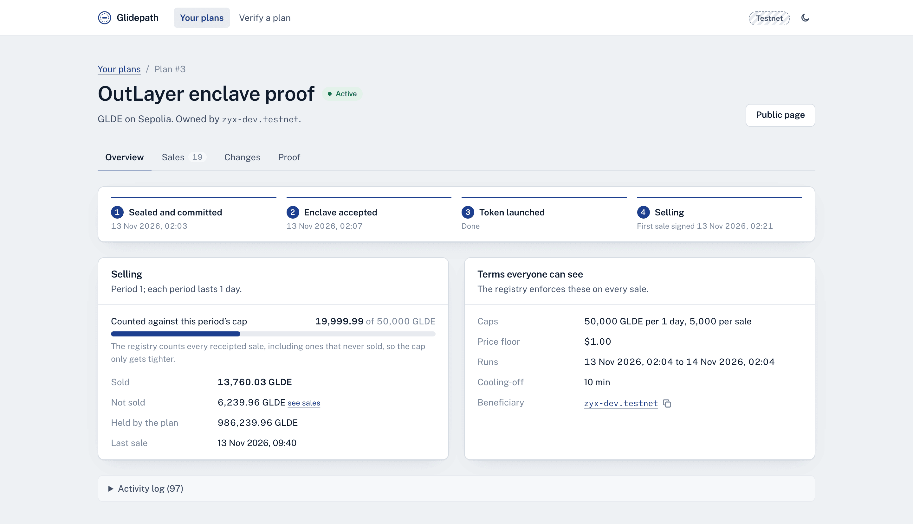
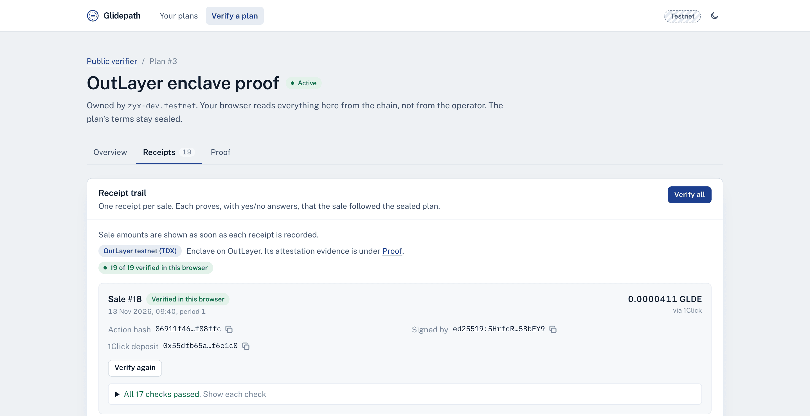
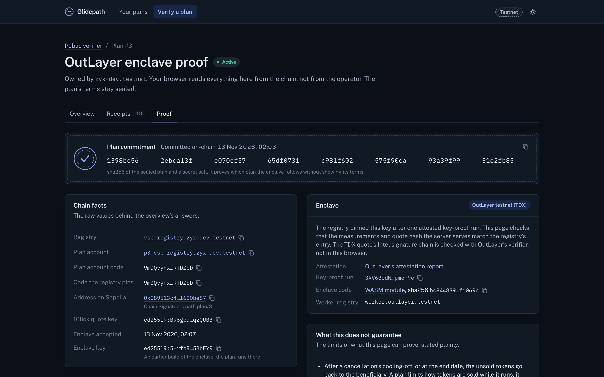
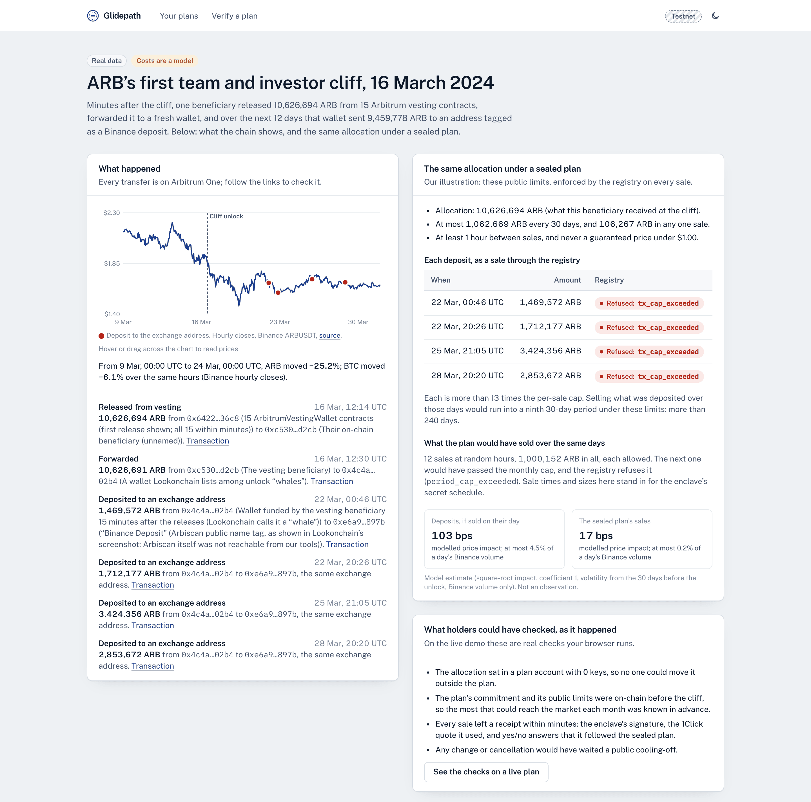
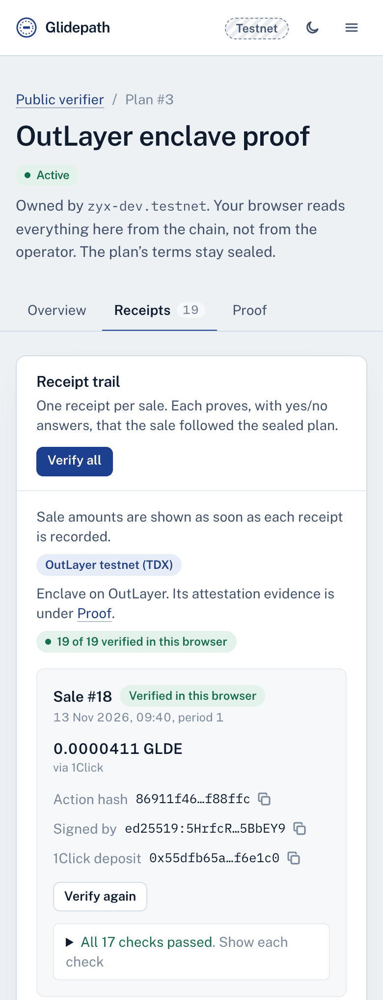

# Glidepath

Glidepath lets token insiders (founders, investors) sell on a schedule they commit to in advance
and nobody else can see, while anyone can check that every sale followed it. It is the crypto
version of a US [Rule 10b5-1 trading plan](https://www.sec.gov/rules-regulations/2022/12/rule-10b5-1-insider-trading-arrangements-related-disclosures),
the pre-arranged selling plans company insiders use, without a broker.

Live at <https://glidepath.clanker.show>, on NEAR testnet and Sepolia. The enclave, the NEAR
contracts and Chain Signatures are real; the 1Click swap service is simulated, because it has no
testnet.

## What it does

Token unlocks hurt holders: Keyrock's study of 16,000+ unlocks found about 90% push the price down
([source](https://keyrock.com/from-locked-to-liquidity-what-16000-token-unlocks-teach-us/)). A
public selling schedule gets sold into early: in our replay of four large unlocks (ARB, OP, APT,
STRK), three tokens did 24–42 points worse than BTC in the 30 days before the date
([method](data/replay/METHOD.md)). A quiet sale can't be checked, which is how the
[Movement scandal](https://www.coindesk.com/tech/2025/04/30/the-protocol-inside-movement-s-token-dump-scandal)
happened. A plan written as an ordinary smart contract would be public, and a broker has to be trusted.

With Glidepath the founder writes the plan in the browser, for example "sell at most 2% a month,
never below $1.50, at random times". The browser encrypts it to an enclave, hardware that runs code
its operator can neither read nor change (an Intel TDX worker on OutLayer), after checking the
enclave's attestation, its signed statement of which code it runs. Only a salted hash of the plan
goes on-chain. The team's tokens are minted straight into a NEAR account with no keys, which moves
them only when the plan's registry contract says so; for an ERC-20, they go to an Ethereum address
that only the registry can have signed, through NEAR Chain Signatures (a network of signers that
signs other chains' transactions on a NEAR contract's request).

The enclave sells at random times through 1Click, NEAR Intents' swap API. The registry enforces
public limits on every sale (per-sale and per-period caps, a price floor, a minimum gap), so even a
broken enclave could not sell more or cheaper than they allow. Every sale leaves a receipt that
anyone can check in the browser. Changing or cancelling the plan is public at once and waits out a
cooling-off period. When the plan ends, what is left goes to the beneficiary, and the plan can be
revealed and checked against the hash published on day one.

## Screenshots

From the live site. Plan #3 is sold by the OutLayer enclave, with GLDE on Sepolia moved by Chain
Signatures.



*A plan from sealing to selling, with the period cap used so far and the limits the registry enforces.*


*After "Verify all", every receipt of plan #3 checks out in the browser against the chain.*


*The day-one commitment, the keyless plan account and its Sepolia address, and the enclave's attestation.*


*ARB's 2024 cliff from Arbitrum One: each real exchange deposit would have been refused by the per-sale cap.*



## Try it

On <https://glidepath.clanker.show>:

1. **See it on a real unlock** → ARB's 2024 cliff, every transfer linked, next to the same tokens under a sealed plan.
2. **Verify a plan** → plan #4 → **Receipts** → **Verify all** → every receipt passes, checked in your browser.
3. **Proof** tab → the plan account has 0 keys, and the enclave's attestation passes.
4. **Create a plan** → fill in the five steps → **Seal and commit** → the plan page, with your plan key to save.
5. **Launch** *SYMBOL* → the team allocation is minted into the plan (an ERC-20 on Sepolia, or a NEAR token).
6. Wait → sales arrive at random times, up to about 10 minutes apart, each with a receipt.
7. **Proof** → **Try to bypass the plan** → under "Add a key to the plan account", **Try it** → refused on-chain.
8. After the end date → **Finalize plan** → the rest goes to the beneficiary; footer → **Red team** shows 26 more attempts.

## Run it locally

Needs Node 24 or newer, pnpm 11 or newer, and Docker (running).

```sh
cp .env.example .env    # every variable is described there; the defaults run everything locally
pnpm install
pnpm dev:local          # local NEAR node and EVM node, API on :4400, web on http://localhost:3400
pnpm demo:full          # in a second terminal: three plans, sales, bypass attempts, receipts checked
```

`pnpm dev:local` needs nothing filled in. It is ready when the log shows `api listening` (and the
web app's `Ready in`); the first run downloads the local NEAR node, so it needs internet. It uses
ports 5437 (Postgres), 4400 (API), 3400 (web), 4420 (NEAR node) and 4430 (EVM node).
`pnpm demo:full` takes about 6 minutes (demo sales are 1–3 minutes apart) and ends with "26
attempts; 0 not refused with the expected code" and a line per receipt checked. Stop everything with
Ctrl-C and `pnpm db:down`. A second copy of the repo on the same
machine should set its own `COMPOSE_PROJECT_NAME` and `DB_VOLUME` in `.env` (both described there),
so it keeps a separate database.

To run against testnet instead (`pnpm dev`), fill in these lines, which are already in `.env`, empty:

| Variable | What it is | Needed for |
|---|---|---|
| `RELAYER_ACCOUNT_ID`, `RELAYER_PRIVATE_KEY` | A funded NEAR testnet account that pays for transactions | `pnpm dev` |
| `EVM_FUNDER_PRIVATE_KEY` | A Sepolia key with faucet ETH, for token deployments and gas | `pnpm dev` with ERC-20 plans |
| `DEPLOY_ACCOUNT_ID`, `DEPLOY_PRIVATE_KEY` | The testnet account that deploys a registry of your own | `pnpm deploy:testnet` |
| `OPERATOR_TOKEN`, `PUBLIC_ORIGIN` | The operator's secret and the site's address on a public server | Public deployments |

## Tests

Postgres must be running (`pnpm db:up`, or a running `pnpm dev:local`). `pnpm test` takes about 20
minutes, the contract tests about 15.

```sh
pnpm db:up
pnpm test && pnpm typecheck && pnpm lint
cd contracts && bash test.sh && cargo fmt --check && cargo clippy --all-targets -- -D warnings
pnpm enclave:wasi
```

The contract tests (157) run in a local NEAR sandbox and cover keyless custody, signed and attested
requests, the public limits, 1Click's real quote signature, cooling-off, the end-of-plan release and
reveal, Chain Signatures failures and a real Sputnik DAO. The engine tests run on real Postgres and
local chains and cover every money failure path, crash recovery and handing a plan to a new enclave
build. `pnpm enclave:wasi` checks that the Rust enclave and its TypeScript reference agree case by
case. The contract and enclave checks need Rust with `cargo-near`, the `wasm32-wasip1` target and
`wasmtime`.

## What is real and what is simulated

| | |
|---|---|
| NEAR | Real: NEAR testnet with the deployed registry (a local node under `pnpm dev:local`) |
| Contracts, keyless accounts, limits, cooling-off, receipts | Real, enforced on-chain |
| Chain Signatures | Real MPC network on testnet (`v1.signer-prod.testnet`); a simulator with the same interface locally |
| ERC-20 sales | Real EIP-1559 transactions on Sepolia, signed through Chain Signatures |
| Enclave | Real on OutLayer testnet (Intel TDX); its keys come from OutLayer's keystore and no operator holds them, and your browser checks its TDX quote up to Intel's root. Each plan is also sealed to a backup build, which sells only if the main one cannot run. Local runs and tests use a labelled simulator |
| 1Click | Its quote-signature scheme is real: checked on-chain by the registry, and a live quote is checked in your browser on the Evidence page. The swap service itself is simulated on its real API (no testnet) and pays in a stand-in USDC |
| Prices | Live Binance and Coinbase prices for listed tokens; a newly launched token has no market, so its price is simulated and labelled |
| Unlock replay | Real historical prices; the market-impact part is a stated model |

## Limits

- It proves how enrolled tokens were handled, not everything the insider does: tokens never
  enrolled, and hedges on derivatives, are out of reach.
- Each sale is a visible transfer when it happens; random timing and sizes reduce what can be
  inferred. Hiding sales needs NEAR's confidential Intents, which are not built: they need a 1Click
  partner key and run on mainnet with real funds.
- OutLayer runs are relayed by an account, which could withhold a signed sale but cannot forge or
  change one. A relay contract would remove even that; it is not built, because OutLayer binds the
  enclave's keys to the calling account, so it would need its own key set and registration.
- Trust in the enclave hardware and the MPC network is narrowed (an allowlist with a public
  activation delay, revocation, and on-chain limits that hold whatever the enclave says), not
  removed. The browser checks the enclave's TDX quote itself: it hashes to the one the registry
  pinned, carries the registered measurements (OutLayer's worker), and is signed through Intel's
  certificate chain up to Intel's root. The quote commits to the run that proved the enclave's
  keys, so the browser also checks that run executed our module and that the key it seals plans to
  is the one that run proved. It does not check Intel's revocation lists or the machine's TCB status
  (patch level): Intel serves that data without CORS, so a browser cannot fetch it.
- On testnet, 1Click quotes are signed by the simulator's key. The registry still binds every quote
  to the sale, the beneficiary and the floor.
- No regulator recognises this as a 10b5-1 plan for tokens.

## Labs: Bitcoin vault (prototype)

The same idea applied to Bitcoin theft and coercion. A vault is a Bitcoin testnet4 address whose
only signer is a NEAR contract, through Chain Signatures. The owner's withdrawals are public at once
and wait out a delay; guardians can veto one, or send everything to a recovery address fixed when
the vault was made. Someone with the owner's key, or forcing the owner, cannot move the coins
faster than the delay. After it, anyone can execute: the contract builds the transaction itself and
the MPC network signs it.

Limits: a withdrawal that has started signing can no longer be vetoed, only replaced by a
claw-back, and replacement is best effort. The contract cannot read Bitcoin, so it trusts the coin
amounts a request names; a wrong amount only produces signatures the network rejects. Not yet run
against live testnet4.

- `pnpm vault:demo --local`: the whole flow on a throwaway sandbox (withdraw, early refusal,
  execute, veto, claw-back), each transaction rebuilt and checked.
- `pnpm vault:deploy --confirm` (about 3 NEAR), then `pnpm vault:demo create --recovery <address>`
  and fund the printed address from a testnet4 faucet; `pnpm vault:demo run --to <address>
  --amount 10000` withdraws, waits, executes and broadcasts.
- Footer → **Labs** → **Bitcoin vault**: the vault read live from NEAR and mempool.space.

## Labs: blind trust (prototype)

The same idea applied to officials' assets. An official puts tokens into a trust run by a mandate
they write once and can no longer read: allowed assets, sectors it never buys, target weights and
trade sizes. The browser seals it to the enclave; the assets sit in an account with no keys; the
enclave rebalances through 1Click. A contract checks every trade against public rules (no excluded
asset, proceeds only back to the trust, a turnover cap, a minimum size and gap), the official has no
way to move the assets, and everything goes to a fixed beneficiary at the end. The public sees the
rules, yes/no statements per trade and receipts it can check; the page shows the official only the
total value.

Limits: balances and each trade's pair and size are public on NEAR, so this hides the holdings from
a casual look, not from someone reading the chain, and an official who remembers the mandate could
work out its trades. "Within the mandate" is the enclave's word; the contract checks the rest. It
runs on a local chain with the simulated enclave and 1Click; the published OutLayer build includes
its operations, but the trust does not use it yet and the contract is not deployed to testnet.

- `pnpm dev:local`, then footer → **Labs** → **Blind trust** → **Seal and create the trust**.
- Open the trust → within a minute the enclave sells the excluded sectors and rebalances →
  **Receipts** → **Verify all**: every check passes in your browser.
- `pnpm trust:deploy` prints the testnet deployment; `--confirm` sends it (about 6 NEAR).

## Repository

```
contracts/          Rust: plan-registry, plan-account, mpc-signer-sim, demo-token, btc-vault, blind-trust, integration-tests
enclave-wasi/       the enclave in Rust: the OutLayer module, checked against the TypeScript reference
packages/           core (plan format, sealing), planner, enclave (simulator), engine (services,
                    durable workflows), verify (in-browser checks), chainsig, btc (Bitcoin vault
                    transactions), trust (blind trust mandate and checks), oneclick, prices,
                    near, evm, db, replay
apps/api, apps/web  Hono API (:4400), Next.js app (:3400)
scripts/            demo, red team, receipt checks, testnet deployment, vault and trust deploys
data/               replay prices, the ARB case, the live 1Click quote, red-team results
deployments/        the deployed testnet addresses (no secrets)
```

Deploying a registry of your own: `pnpm deploy:testnet --local` rehearses it on a throwaway sandbox,
and `pnpm deploy:testnet` deploys from `DEPLOY_*` in `.env` (about 20 testnet NEAR; it deletes the
registry's own key and checks it has none).

## Libraries

near-sdk 5.30, near-contract-standards, k256, sha3, uint, ripemd, near-workspaces (Rust); near-api-js 7,
near-sandbox, viem, Hardhat 3, solc, @noble/curves, @noble/hashes, @noble/ciphers, @scure/base, Zod 4, Hono,
Drizzle, pg, DBOS, Next.js 16, React 19, Tailwind 4, Vitest, Biome, Turbo. Sputnik DAO v2 (MIT) is
used in tests only.

## Licence

MIT, see [LICENSE](LICENSE). From the same builder: [Hustle](https://github.com/the-wunmi/hustle)
(<https://hustle.clanker.show>), a browser game on NEAR in which AI agents work for pay and must
cover their own costs.
